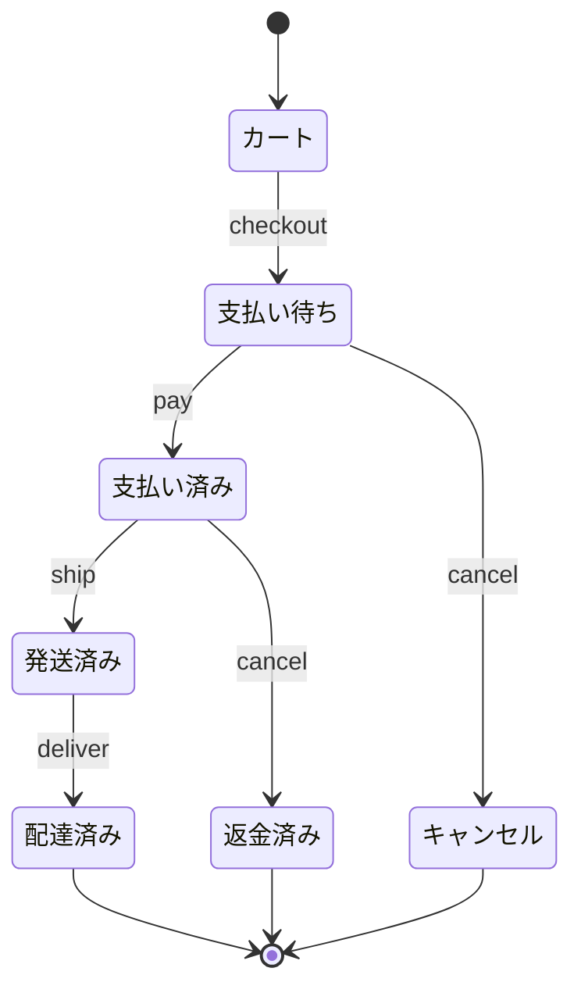

# 注文の状態

カート → 注文確定 → 支払い → 発送 → 配達。支払い前の取り消しはキャンセル、支払い後は返金。

## 出力

| 出力  | 型     | 意味                                   |
|-------|--------|----------------------------------------|
| state | 文字列 | 操作の後の状態                         |
| error | 文字列 | できない操作のとき INVALID_TRANSITION |

## 状態遷移: 注文ライフサイクル (1-switch)

図に矢印がない操作（例: カートで pay）は、すべて「できない操作」として検査する。
